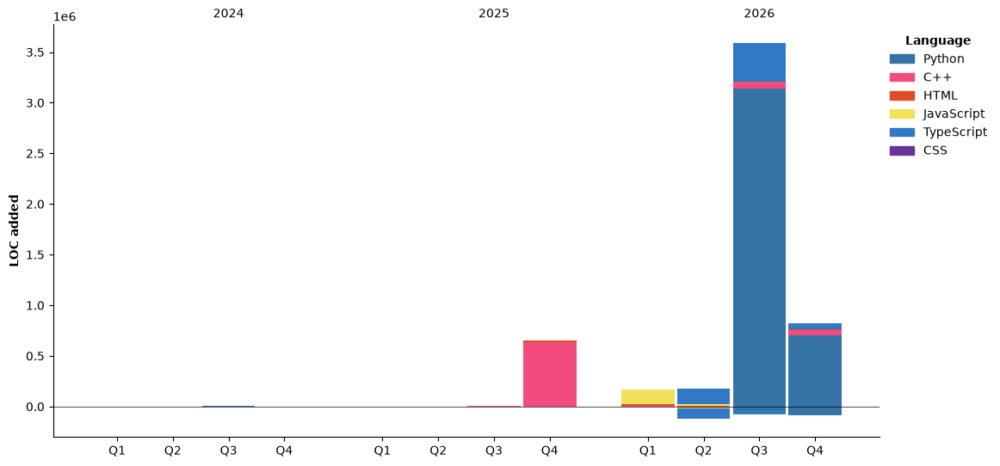

<p align="center">
  
</p>

<p align="center">
  
</p>


## About

I like understanding systems end to end. I'm currently exploring frontend design, git workflows, backend development, full-stack development, physical simulations, and project management — building hands-on in each rather than just reading about them. Where I've gone deepest is automation: I design and ship n8n + WhatsApp API workflows that qualify leads and save businesses real time and money, which is the core of what I'm building at Adesse.


## Experience

**Founder & Developer — Adesse**
Building automation systems with n8n and the WhatsApp API that qualify leads and save businesses time and money.

**Web Developer — [VantTec](https://github.com/vanttec)**
VantTec is a multidisciplinary student team at Tecnológico de Monterrey that designs, builds, and programs unmanned autonomous vehicles. I build and maintain the team's official website (React).


## Education

**Tecnológico de Monterrey** — B.S. in Computer Science
High-performing student — GPA 99/100


## Projects

**[Hermes](https://github.com/DiegoGalloM/Hermes)**
AI-powered news pipeline: collects stories from NewsAPI and RSS, curates and summarizes them with the Claude API, and delivers a daily digest straight to Telegram.

**[CSV-Analyzer](https://github.com/DiegoGalloM/CSV-Analyzer)**
Interactive C++20 CSV analysis tool with adaptive type detection, template metaprogramming (`std::variant`), and statistical summaries rendered as ASCII histograms. Final project for Object-Oriented Programming.

**[Electromagnetic Particle Confinement](https://github.com/DiegoGalloM/Proyeto-Reto-Magn-tico)** · [live demo](https://magchallenge.netlify.app)
Simulated a charged particle confined by magnetic fields — from the Lorentz force to a 3D tokamak reactor. Implemented the RK4 integrator and the active, sectorized control system that keeps the particle confined in real time.


## Hackathons

🏆 **HackMTY — [Smart Intelligence](https://github.com/Tabo462/Hackmty_Smart_Intelligence)** — 1st place
Airline catering analytics platform (FastAPI, Snowflake, Random Forest, Gemini AI). My part: API integrations and the frontend. Team project — full credit to the team in the repo.

🏆 **Capital One Sprint — [MatchUp](https://github.com/Fernando-Mauro/sprint-capital-one)** — 1st place
Pick-up sports matchup app (Next.js, Supabase). My part: backend and the Supabase database. Team project — full credit to the team in the repo.


## Tech Stack

<p align="center">
  
  
  
  
  
  
  
  
  
</p>


## GitHub Stats

<p align="center">
  
  
</p>

<p align="center">
  
</p>


## Coding Activity

<!--START_SECTION:waka-->


**🐱 My GitHub Data** 

> 📦 304.1 kB Used in GitHub's Storage 
 > 
> 🏆 476 Contributions in the Year 2026
 > 
> 🚫 Not Opted to Hire
 > 
> 📜 12 Public Repositories 
 > 
> 🔑 12 Private Repositories 
 > 
**I'm an Early 🐤** 

```text
🌞 Morning                1010 commits        ███████████░░░░░░░░░░░░░░   44.05 % 
🌆 Daytime                698 commits         ████████░░░░░░░░░░░░░░░░░   30.44 % 
🌃 Evening                486 commits         █████░░░░░░░░░░░░░░░░░░░░   21.19 % 
🌙 Night                  99 commits          █░░░░░░░░░░░░░░░░░░░░░░░░   04.32 % 
```
📅 **I'm Most Productive on Tuesday** 

```text
Monday                   405 commits         ████░░░░░░░░░░░░░░░░░░░░░   17.66 % 
Tuesday                  463 commits         █████░░░░░░░░░░░░░░░░░░░░   20.19 % 
Wednesday                256 commits         ███░░░░░░░░░░░░░░░░░░░░░░   11.16 % 
Thursday                 325 commits         ████░░░░░░░░░░░░░░░░░░░░░   14.17 % 
Friday                   433 commits         █████░░░░░░░░░░░░░░░░░░░░   18.88 % 
Saturday                 282 commits         ███░░░░░░░░░░░░░░░░░░░░░░   12.30 % 
Sunday                   129 commits         █░░░░░░░░░░░░░░░░░░░░░░░░   05.63 % 
```


📊 **This Week I Spent My Time On** 

```text
🕑︎ Time Zone: America/Bogota

💬 Programming Languages: 
Python                   5 hrs 30 mins       ██████████░░░░░░░░░░░░░░░   40.35 % 
C++                      3 hrs 10 mins       ██████░░░░░░░░░░░░░░░░░░░   23.29 % 
Markdown                 1 hr 35 mins        ███░░░░░░░░░░░░░░░░░░░░░░   11.67 % 
JavaScript               1 hr 25 mins        ███░░░░░░░░░░░░░░░░░░░░░░   10.44 % 
TypeScript               44 mins             █░░░░░░░░░░░░░░░░░░░░░░░░   05.42 % 

🔥 Editors: 
VS Code                  7 hrs 18 mins       █████████████░░░░░░░░░░░░   53.59 % 
Claude Code              5 hrs 23 mins       ██████████░░░░░░░░░░░░░░░   39.44 % 
Copilot CLI              56 mins             ██░░░░░░░░░░░░░░░░░░░░░░░   06.91 % 
Codex Vscode             0 secs              ░░░░░░░░░░░░░░░░░░░░░░░░░   00.05 % 
Copilot                  0 secs              ░░░░░░░░░░░░░░░░░░░░░░░░░   00.00 % 

🐱‍💻 Projects: 
SMALC-AD26               4 hrs 27 mins       ████████░░░░░░░░░░░░░░░░░   32.64 % 
VS-Code                  3 hrs 26 mins       ██████░░░░░░░░░░░░░░░░░░░   25.25 % 
commons-modelo           3 hrs 12 mins       ██████░░░░░░░░░░░░░░░░░░░   23.48 % 
Website-VantTec          54 mins             ██░░░░░░░░░░░░░░░░░░░░░░░   06.65 % 
TCC                      53 mins             ██░░░░░░░░░░░░░░░░░░░░░░░   06.59 % 

💻 Operating System: 
Windows                  13 hrs 39 mins      █████████████████████████   100.00 % 
```

🤖 **AI Coding This Week** 

```text
⏱ AI Coding Time: 7 hrs 48 mins (57.23%)

✍️ 16,066 lines written by AI, 713 lines written by hand (95.75% AI-written)

🔤 3,171,259 Input Tokens, 1,258,969 Output Tokens

💵 $61.70 Estimated AI Cost This Week

🧠 26 AI Sessions, 56 AI Prompts

Opus                     13,871 lines        █████████████████████░░░░   85.28 % 
Fable                    2,326 lines         ████░░░░░░░░░░░░░░░░░░░░░   14.30 % 
GPT                      47 lines            ░░░░░░░░░░░░░░░░░░░░░░░░░   00.29 % 
Sonnet                   21 lines            ░░░░░░░░░░░░░░░░░░░░░░░░░   00.13 % 

🔎 AI Coding Insights:
🤖 AI-Driven — 95.75% of written lines came from AI
📚 Verbose Prompter — average 2,254 characters per prompt
🔁 Iterative Prompter — average 2 prompts per session
🚀 High AI Trust — 13.96% of changed lines were hand-edited
```

**Timeline**




 Last Updated on 15/11/2026 23:07:23 UTC
<!--END_SECTION:waka-->


## Activity

<p align="center">
  
</p>

<p align="center">
  
</p>

<p align="center"><sub>Beyond code: philosophy, functional fitness, discretionary trading, and documenting the process.</sub></p>
