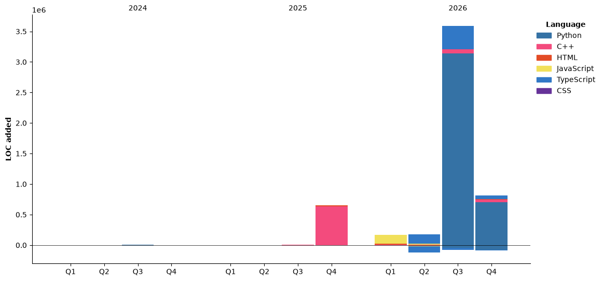

<p align="center">
  
</p>

<p align="center">
  
</p>


## About

I like understanding systems end to end. I'm currently exploring frontend design, git workflows, backend development, full-stack development, physical simulations, and project management — building hands-on in each rather than just reading about them. Where I've gone deepest is automation: I design and ship n8n + WhatsApp API workflows that qualify leads and save businesses real time and money, which is the core of what I'm building at Adesse.


## Experience

**Founder & Developer — Adesse**
Building automation systems with n8n and the WhatsApp API that qualify leads and save businesses time and money.

**Web Developer — [VantTec](https://github.com/vanttec)**
VantTec is a multidisciplinary student team at Tecnológico de Monterrey that designs, builds, and programs unmanned autonomous vehicles. I build and maintain the team's official website (React).


## Education

**Tecnológico de Monterrey** — B.S. in Computer Science
High-performing student — GPA 99/100


## Projects

**[Hermes](https://github.com/DiegoGalloM/Hermes)**
AI-powered news pipeline: collects stories from NewsAPI and RSS, curates and summarizes them with the Claude API, and delivers a daily digest straight to Telegram.

**[CSV-Analyzer](https://github.com/DiegoGalloM/CSV-Analyzer)**
Interactive C++20 CSV analysis tool with adaptive type detection, template metaprogramming (`std::variant`), and statistical summaries rendered as ASCII histograms. Final project for Object-Oriented Programming.

**[Electromagnetic Particle Confinement](https://github.com/DiegoGalloM/Proyeto-Reto-Magn-tico)** · [live demo](https://magchallenge.netlify.app)
Simulated a charged particle confined by magnetic fields — from the Lorentz force to a 3D tokamak reactor. Implemented the RK4 integrator and the active, sectorized control system that keeps the particle confined in real time.


## Hackathons

🏆 **HackMTY — [Smart Intelligence](https://github.com/Tabo462/Hackmty_Smart_Intelligence)** — 1st place
Airline catering analytics platform (FastAPI, Snowflake, Random Forest, Gemini AI). My part: API integrations and the frontend. Team project — full credit to the team in the repo.

🏆 **Capital One Sprint — [MatchUp](https://github.com/Fernando-Mauro/sprint-capital-one)** — 1st place
Pick-up sports matchup app (Next.js, Supabase). My part: backend and the Supabase database. Team project — full credit to the team in the repo.


## Tech Stack

<p align="center">
  
  
  
  
  
  
  
  
  
</p>


## GitHub Stats

<p align="center">
  
  
</p>

<p align="center">
  
</p>


## Coding Activity

<!--START_SECTION:waka-->


**🐱 My GitHub Data** 

> 📦 287.2 kB Used in GitHub's Storage 
 > 
> 🏆 441 Contributions in the Year 2026
 > 
> 🚫 Not Opted to Hire
 > 
> 📜 12 Public Repositories 
 > 
> 🔑 11 Private Repositories 
 > 
**I'm an Early 🐤** 

```text
🌞 Morning                1001 commits        ███████████░░░░░░░░░░░░░░   45.44 % 
🌆 Daytime                670 commits         ████████░░░░░░░░░░░░░░░░░   30.41 % 
🌃 Evening                442 commits         █████░░░░░░░░░░░░░░░░░░░░   20.06 % 
🌙 Night                  90 commits          █░░░░░░░░░░░░░░░░░░░░░░░░   04.09 % 
```
📅 **I'm Most Productive on Tuesday** 

```text
Monday                   386 commits         ████░░░░░░░░░░░░░░░░░░░░░   17.52 % 
Tuesday                  462 commits         █████░░░░░░░░░░░░░░░░░░░░   20.97 % 
Wednesday                236 commits         ███░░░░░░░░░░░░░░░░░░░░░░   10.71 % 
Thursday                 324 commits         ████░░░░░░░░░░░░░░░░░░░░░   14.71 % 
Friday                   433 commits         █████░░░░░░░░░░░░░░░░░░░░   19.66 % 
Saturday                 270 commits         ███░░░░░░░░░░░░░░░░░░░░░░   12.26 % 
Sunday                   92 commits          █░░░░░░░░░░░░░░░░░░░░░░░░   04.18 % 
```


📊 **This Week I Spent My Time On** 

```text
🕑︎ Time Zone: America/Bogota

💬 Programming Languages: 
C++                      2 hrs 26 mins       ███████████████░░░░░░░░░░   61.07 % 
Markdown                 38 mins             ████░░░░░░░░░░░░░░░░░░░░░   16.23 % 
Python                   32 mins             ███░░░░░░░░░░░░░░░░░░░░░░   13.62 % 
C                        7 mins              █░░░░░░░░░░░░░░░░░░░░░░░░   02.94 % 
Other                    6 mins              █░░░░░░░░░░░░░░░░░░░░░░░░   02.59 % 

🔥 Editors: 
VS Code                  2 hrs 27 mins       ███████████████░░░░░░░░░░   61.56 % 
Claude Code              59 mins             ██████░░░░░░░░░░░░░░░░░░░   24.63 % 
Copilot CLI              32 mins             ███░░░░░░░░░░░░░░░░░░░░░░   13.46 % 
Codex Vscode             0 secs              ░░░░░░░░░░░░░░░░░░░░░░░░░   00.35 % 

🐱‍💻 Projects: 
VS-Code                  1 hr 24 mins        █████████░░░░░░░░░░░░░░░░   35.10 % 
TC1031-Act1.3            1 hr 13 mins        ████████░░░░░░░░░░░░░░░░░   30.42 % 
work                     54 mins             ██████░░░░░░░░░░░░░░░░░░░   22.50 % 
Integración API          10 mins             █░░░░░░░░░░░░░░░░░░░░░░░░   04.30 % 
Captura_Imagenes_ESP     7 mins              █░░░░░░░░░░░░░░░░░░░░░░░░   03.12 % 

💻 Operating System: 
Windows                  4 hrs               █████████████████████████   100.00 % 
```

🤖 **AI Coding This Week** 

```text
⏱ AI Coding Time: 1 hr 56 mins (48.31%)

✍️ 841 lines written by AI, 215 lines written by hand (79.64% AI-written)

🔤 1,628,403 Input Tokens, 214,684 Output Tokens

💵 $8.45 Estimated AI Cost This Week

🧠 8 AI Sessions, 26 AI Prompts

Opus                     794 lines           ████████████████████████░   94.19 % 
GPT                      49 lines            █░░░░░░░░░░░░░░░░░░░░░░░░   05.81 % 

🔎 AI Coding Insights:
🤖 AI-Driven — 79.64% of written lines came from AI
📄 Detailed Prompter — average 836 characters per prompt
🔁 Iterative Prompter — average 3 prompts per session
🚀 High AI Trust — 21.94% of changed lines were hand-edited
```

**Timeline**




 Last Updated on 07/11/2026 22:15:44 UTC
<!--END_SECTION:waka-->


## Activity

<p align="center">
  
</p>

<p align="center">
  
</p>

<p align="center"><sub>Beyond code: philosophy, functional fitness, discretionary trading, and documenting the process.</sub></p>
